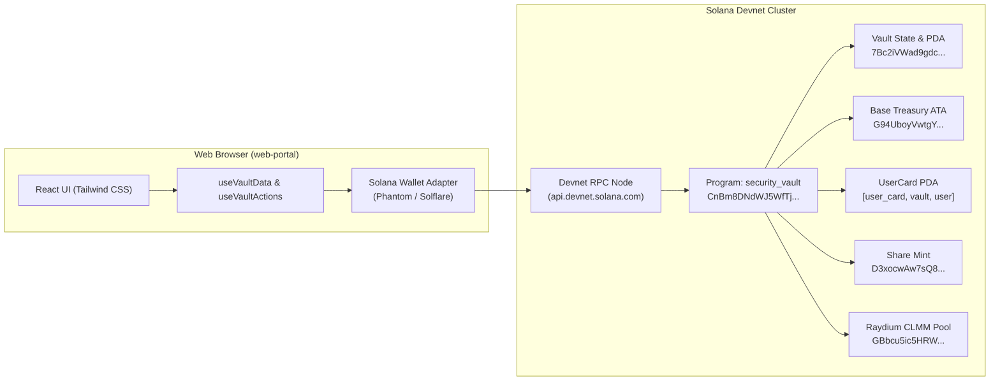

# SolFlow — Solana Web3 & DS/ML Practice Hub (Devnet)

Учебный и итоговый стартап-проект по курсу **«ИТ-стартап Итоговый проект 1 (DS/ML стартап)»** (AlmaU): смарт-контракты на **Rust и Anchor**, автономный DeFi AMM-пул, 3-уровневый CPI-роутер, лаборатория безопасности (Exploit → Patch), стейблкоин-платежи с **Solana Pay URI** и финальное веб-приложение **SolFlow** с живым RPC-мониторингом и ML-скорингом рисков. Все сетевые сценарии развёрнуты и подтверждены в **Solana Devnet**.

## Технологии
`Rust` · `Anchor 0.30.1` · `Solana Devnet` · `TypeScript` · `Node.js` · `@solana/web3.js` · `@solana/spl-token` · `Metaplex Token Metadata` · `SPL Memo` · `Solana Pay`

## Задеплоенные программы (Solana Devnet)

| Неделя | Программа | Назначение | Program ID |
| :--- | :--- | :--- | :--- |
| **9** | `defi_swap` | Автономный AMM-пул (`x * y = k`, комиссия 0.30%) на SPL Token | [`9tXLf1ZEbjycpb3E2vcBqbfe6DAnLYuxpWjtYBDaLZtM`](https://explorer.solana.com/address/9tXLf1ZEbjycpb3E2vcBqbfe6DAnLYuxpWjtYBDaLZtM?cluster=devnet) |
| **11** | `composable_router` | Composable CPI-роутер (`router` → `defi_swap` → `SPL Token` + `SPL Memo`) | [`9t56Ysmdii2T2fk6cnXihjW5Q1k7WCCspD7wsMFQzrB4`](https://explorer.solana.com/address/9t56Ysmdii2T2fk6cnXihjW5Q1k7WCCspD7wsMFQzrB4?cluster=devnet) |
| **12** | `security_vault` | Security Lab: уязвимость Missing Signer Check, exploit и патч | [`CnBm8DNdWJ5WfTj92czXWm9PHad8fseYeWgBZ3535qkP`](https://explorer.solana.com/address/CnBm8DNdWJ5WfTj92czXWm9PHad8fseYeWgBZ3535qkP?cluster=devnet) |
| **13** | `stablecoin_pay` | Ончейн-инвойсы в `mUSDC`, Solana Pay URI и защита `AlreadyPaid` | [`8xSmfQW68bK4GzSfMk2iELyyVuPzdWEokpBHKCtrYjd9`](https://explorer.solana.com/address/8xSmfQW68bK4GzSfMk2iELyyVuPzdWEokpBHKCtrYjd9?cluster=devnet) |

## Практические работы (Недели 1–15)

| Неделя / Работа | Что реализовано | Статус |
| :--- | :--- | :--- |
| Недели 1–3 — Основы Solana и Rust CLI | Кошелёк, разбор транзакций, аккаунты, инструкции, обработка ошибок | Проверено локально |
| Неделя 4 — Программа Solana на Rust | Точка входа и вывод параметров инструкции | Код подготовлен |
| Неделя 5 — Anchor Counter | Создание и увеличение счётчика | Контракт готов; локальный тест |
| Неделя 6 — PDA-профили | Создание и обновление профиля владельцем | Контракт готов |
| Неделя 7 — SPL Tokens | Mint, ATA, выпуск 1000 AAT, перевод 250 AAT и метаданные Metaplex | Выполнено в Devnet |
| Неделя 8 (РК1) — Profile Rewards | Профиль, репутация и награды через CPI | Собрано; локальные тесты |
| Неделя 9 — DeFi (`defi_swap`) | AMM-пул `x * y = k`, PDA-хранилища `vault_a`/`vault_b` и реальный своп | Задеплоено и проверено в Devnet |
| Неделя 10 — RPC & Blockchain Data | Веб-дашборд: баланс SOL, SPL-токены, резервы пула и история транзакций | Проверено в Devnet |
| Неделя 11 — CPI (`composable_router`) | Атомарный 3-уровневый CPI: `router` → `defi_swap` → `SPL Token` + `SPL Memo` | Задеплоено и проверено в Devnet |
| Неделя 12 — Security & Exploit Lab | Exploit Missing Signer Check → патч `Signer<'info>` → блокировка `AccountNotSigner` | Задеплоено и проверено в Devnet |
| Неделя 13 — Stablecoin Pay | Ончейн-инвойсы в тестовом `mUSDC`, Solana Pay URI, защита `AlreadyPaid (0x1771)` | Задеплоено и проверено в Devnet |
| Недели 14–15 (РК2) — **SolFlow Capstone** | Единый Web3 + DS/ML dApp: Live RPC, AI Risk Score, Live CPI Swap, Stablecoin Pay + QR, Security Audit | Работает в Devnet |

## Подтверждённые результаты в Solana Devnet

- **Кошелёк разработчика:** `F8VD2NvjMKSSDqRSDpTYzL2wrVyeDzt3zEDweSqmQqcM`
- **Неделя 7 (AAT Token):** Mint `EpzAym5odoPL4iFEkTKUUsBiCgsi9o7qcngnnZCtEozA` (Sender: `750 AAT`, Receiver: `250 AAT`)
- **Неделя 9 (AMM Swap `-100 A` → `+90.66 B`):** [`GtvqmbqYaqgY...`](https://explorer.solana.com/tx/GtvqmbqYaqgY7mPAye4mRzF6vFH4x3TNqZUoToiyCzhkV2jwUV6wLALXNCREQjRaZGB6KpVFSgTvSE1D4uh47JR?cluster=devnet)
- **Неделя 11 (3-уровневый CPI + SPL Memo):** [`4mYSDhgN6NiL...`](https://explorer.solana.com/tx/4mYSDhgN6NiL7iWGs1qdrZSot7HNLgoaeknKT46D75ZJv2cN7nEKsTboSZxTD2bhGvhSgzwQ214nc6pJ8vT7XzJW?cluster=devnet)
- **Неделя 12 (Security Exploit → Patch):**
  - Успешный exploit до патча (`-5 000 000 lamports` без подписи владельца): [`2ax4tRLgeTza...`](https://explorer.solana.com/tx/2ax4tRLgeTza3vRSuzjCXvcC7Y9SrnbquXXvn3x3Fy3kUemGeYUzVUBfRQeU6Vtty2zW1GgSmcwCyG7jXZXvReES?cluster=devnet)
  - Легитимный вывод после патча (`Signer<'info>`): [`3DvUED45c9xk...`](https://explorer.solana.com/tx/3DvUED45c9xkZqF8vhnQFZsnx2vZqSCHDuxqE8kpXB9KcNeCd2PHDxWceJiUJVvhNx7sYekKfaUxHSeNH38LrNLB?cluster=devnet)
- **Неделя 13 (Stablecoin Pay):** `mUSDC` Mint `BZQCLuDX5y9FW5Fd71LjMpTUNHcvK4P2ASgwgyYYPtN7` · Invoice PDA `2MEURRSLvnSibStvvKciu7RpKMFC7xSJh7FS2pqQgm6e`
- **Недели 14–15 (SolFlow Capstone):**
  - Live CPI Routed Swap: [`4ccn3NJe1UqJ...`](https://explorer.solana.com/tx/4ccn3NJe1UqJ76gQMvMYa5PK26fZPrcdx3LLsaAkPVvcWhgNvFgDJgumGTi3LPFGgWchz4BT54LfmsJ756yKEJKi?cluster=devnet)
  - Live mUSDC Invoice: [`5UFuatjhseYr...`](https://explorer.solana.com/tx/5UFuatjhseYrehTYHfV2u18SBJ1hMbTtx5UVDyqJ9P1cEGRBQjokUirhhfUNEGDiDHX4WKgBynEyu1UzTX6q5UXr?cluster=devnet)

## Структура проекта

```text
programs/
  defi_swap/           # Неделя 9: автономный AMM-пул (x * y = k)
  composable_router/   # Неделя 11: CPI-роутер (defi_swap + SPL Memo)
  security_vault/      # Неделя 12: Security & Exploit Lab (patched)
  stablecoin_pay/      # Неделя 13: стейблкоин-инвойсы и Solana Pay
  profile_rewards/     # Неделя 8: on-chain профиль и награды
  profile/             # Неделя 6: PDA-профили
  counter/             # Неделя 5: Anchor Counter
tests/
  defi_swap.ts                 # Интеграционный тест AMM-пула
  composable_router.ts         # Тест 3-уровневого CPI и on-chain логов
  security_vault_exploit.ts    # Тест exploit (vulnerable / patched)
  stablecoin_pay.ts            # Тест инвойсов, Solana Pay и AlreadyPaid
  spl-token.ts                 # Интеграционный тест Недели 7
  mvp.ts                       # Интеграционный тест Недели 8
dashboard/                     # Неделя 10: Live Devnet RPC Dashboard
capstone/                      # Недели 14–15: SolFlow AI DeFi & Stablecoin Pay Hub
docs/                          # Отчёты по Неделям 9–15 и план Demo Day

## Week 11: Концентрированная ликвидность (Raydium CLMM в Devnet)

### 1. Отличие CLMM от классического AMM ($x \cdot y = k$), роль тиков и NFT-позиции

- **Классический AMM ($x \cdot y = k$):** Ликвидность распределяется равномерно по всей бесконечной кривой цен от $0$ до $+\infty$. В результате подавляющая часть предоставленного капитала простаивает вне текущего торгового диапазона, приводя к низкой эффективности капитала (capital inefficiency) и высокому проскальзыванию (slippage) при крупных сделках.
- **CLMM (Concentrated Liquidity Market Maker):** Ликвидность концентрируется внутри заданного поставщиком диапазона цен $[P_{\min}, P_{\max}]$. Капитал используется в десятки и сотни раз эффективнее, принося более высокие комиссии на единицу вложенных средств при нахождении цены внутри интервала.
- **Тики (Ticks) и Tick Spacing:** Ценовое пространство разбито на дискретные точки — тики, где цена на тике $i$ задаётся соотношением $P(i) = 1.0001^i$. Торговля и пересчёт ликвидности происходят дискретно по тикам с шагом `tickSpacing` (в данном пуле 60 тиков на шаг).
- **NFT-позиция (Non-Fungible Position):** В классическом AMM поставщик получает взаимозаменяемые LP-токены (SPL Fungible Tokens), так как условия для всех провайдеров идентичны. В CLMM каждая позиция уникальна (индивидуальный диапазон $[tick_{\min}, tick_{\max}]$, объём ликвидности, накопленные комиссии), поэтому право собственности на позицию и её параметры оборачиваются в отдельный SPL NFT.

### 2. Команды для воспроизведения (`clmm-tools/`)

В директории `clmm-tools/` реализован CLI-инструментарий на TypeScript для взаимодействия с Raydium CLMM:

- `npm run mint` — создание котируемого токена `mUSDC`, проверка/подключение базового токена и минт по 100 000 единиц каждого на ATA кошелька.
- `npm run pool` — инициализация CLMM-пула в Raydium с тиром комиссии 0.25% (`tickSpacing: 60`) и стартовой ценой.
- `npm run lp` — расчёт тиков и открытие концентрированной NFT-позиции в асимметричном диапазоне.
- `npm run inspect` — считывание ончейн-состояния пула (текущая цена, активный тик, суммарная ликвидность) и параметров открытой NFT-позиции.

### 3. Ончейн-артефакты в Solana Devnet (Explorer)

Все транзакции и аккаунты подтверждены в **Solana Devnet** (из `clmm-tools/devnet-state.json`):

- **Базовый токен (Base Mint):** [`6frqPxC5jtzSk1P3eS6xqFvTq6yY5b2ujDwtw5w2g6A1`](https://explorer.solana.com/address/6frqPxC5jtzSk1P3eS6xqFvTq6yY5b2ujDwtw5w2g6A1?cluster=devnet)
- **Котируемый токен (Quote Mint / mUSDC):** [`B4EyXuMSht7WSreK4zzazUf7rLsSULSvBX2XuCbxnvy`](https://explorer.solana.com/address/B4EyXuMSht7WSreK4zzazUf7rLsSULSvBX2XuCbxnvy?cluster=devnet)
- **CLMM Пул (Pool ID):** [`GBbcu5ic5HRWaWqF5kwurkoE4xmEWCiujUGXK4CgfzHY`](https://explorer.solana.com/address/GBbcu5ic5HRWaWqF5kwurkoE4xmEWCiujUGXK4CgfzHY?cluster=devnet)
- **Транзакция создания пула:** [`5dLyiwffWSwUFH7Bi6TD1ZguwAGvLp66uBPSA75CBZY4zTLENFp5svS98Vg8FJR7jNzZgaSY2Qk4yn2ysFHZPsTg`](https://explorer.solana.com/tx/5dLyiwffWSwUFH7Bi6TD1ZguwAGvLp66uBPSA75CBZY4zTLENFp5svS98Vg8FJR7jNzZgaSY2Qk4yn2ysFHZPsTg?cluster=devnet)
- **NFT Mint открытой позиции:** [`3eP9acZtNW6vyFgWW2rLpBqSKD7ZLnbfr7hjdfqqDhD3`](https://explorer.solana.com/address/3eP9acZtNW6vyFgWW2rLpBqSKD7ZLnbfr7hjdfqqDhD3?cluster=devnet)
- **Транзакция открытия LP-позиции:** [`4cFYVgkhwx2hAfwWYqc8xwoVrXfv362JpmvRofcPKGQFLAFfGh6kQX25cFG61iNzKasEs6vLh9pEpPE4QBpwsWe8`](https://explorer.solana.com/tx/4cFYVgkhwx2hAfwWYqc8xwoVrXfv362JpmvRofcPKGQFLAFfGh6kQX25cFG61iNzKasEs6vLh9pEpPE4QBpwsWe8?cluster=devnet)

### 4. Обоснование асимметричного диапазона (-15% / +25%)

Выбор асимметричного ценового коридора $[-15\%, +25\%]$ (`priceLower: 0.212500`, `priceUpper: 0.312500`, тики `[-15540, -11640]`):
- **Учёт бычьего тренда (Bullish Skew):** Для развивающихся токенов экосистемы восходящая волатильность обычно превосходит нисходящую. Расширенный верхний предел ($+25\%$) позволяет позиции оставаться активной и генерировать торговые комиссии при росте курса токена без преждевременного полного выхода в котируемый стейблкоин.
- **Ограничение риска просадки (Downside Protection):** Сужение нижнего диапазона до $-15\%$ минимизирует риск глубоких непостоянных потерь (impermanent loss) и предотвращает накопление обесценивающегося актива при резком дампе: при падении ниже $0.2125$ позиция полностью переходит в базовый актив, фиксируя границу убытка от продолжения падения внутри пула.
- **Оптимизация плотности капитала:** Сжатие диапазона до 40% ширины (вместо бесконечного $[0, \infty]$) повышает плотность ликвидности и объём генерируемых протокольных комиссий более чем в 5 раз по сравнению со стандартным пулом $x \cdot y = k$.

## Week 12: CPI-своп через Raydium CLMM и защита от slippage

### 1. Архитектура ончейн-аккаунтов: `SwapRoute` и `quote_treasury`

- **Аккаунт `SwapRoute` (PDA `[b"swap_route", vault.key()]`):**
  Хранит связку между конкретным хранилищем `Vault`, авторизованным пулом Raydium CLMM `pool_state`, котируемым минтом `quote_mint` и казначейским токен-аккаунтом `quote_treasury`.
  *Зачем вынесен в отдельный PDA?*
  Вынесение маршрута обмена в отдельный изолированный PDA-аккаунт отделяет базовое состояние хранилища (`Vault`: права администратора, базовый баланс) от изменяемой DeFi-инфраструктуры. Это позволяет безопасно перенастраивать или обновлять торговый маршрут (например, при смене пула Raydium или переходе на другой тир комиссии) без риска изменения прав доступа к самому Vault.
- **Токен-аккаунт `quote_treasury` (PDA `[b"quote_treasury", vault.key()]`):**
  Ончейн-хранилище котируемых токенов (`mUSDC`), где владельцем (`authority`) назначен сам `Vault` PDA. Программа инициализирует его через Anchor-макрос `token::authority = vault`, что гарантирует невозможность прямого вывода средств в обход логики смарт-контракта хранилища.

### 2. Инструкции контракта: `configure_swap_route` и `execute_clmm_swap`

- **`configure_swap_route`:**
  - Доступна исключительно администратору хранилища (`has_one = authority`).
  - Валидирует аккаунт пула: проверяет, что его владельцем выступает программа Raydium CLMM (`DRayAUgENGQBKVaX8owNhgzkEDyoHTGVEGHVJT1E9pfH`).
  - Парсит срез данных пула (`mintA` и `mintB`) и проверяет, что они строго соответствуют паре `(vault_mint, quote_mint)` в любом порядке (иначе ошибка `InvalidPoolMints`).
  - Фиксирует конфигурацию в аккаунте `SwapRoute` и автоматически инициализирует казначейство `quote_treasury`.
- **`execute_clmm_swap`:**
  - Доступна только администратору (`has_one = authority`).
  - Принимает параметры `SwapParams { direction, amount_in, min_amount_out }`.
  - Проверяет `amount_in > 0` (`ZeroSwapAmount`) и соответствие переданного пула зарегистрированному `swap_route.pool_state` (`UnauthorizedPool`).
  - На основе `SwapDirection` (`BaseToQuote` или `QuoteToBase`) определяет входящие и исходящие токен-аккаунты, минты и резервуары пула (`vaultA` / `vaultB`).
  - Формирует межпрограммный вызов (CPI) к инструкции `swap_v2` в Raydium CLMM с 8-байтным дискриминатором `[43, 4, 237, 11, 26, 201, 30, 98]`.
  - Подписывает вызов PDA-сидами хранилища (`[b"vault", authority.key(), &[bump]]`), передавая `remaining_accounts` (bitmap extension и актуальные tick arrays).
  - Эмитит ончейн-событие `ClmmSwapExecuted`.

### 3. Ончейн-артефакты и транзакции в Solana Devnet

- **Программа Vault (Security Vault):** [`CnBm8DNdWJ5WfTj92czXWm9PHad8fseYeWgBZ3535qkP`](https://explorer.solana.com/address/CnBm8DNdWJ5WfTj92czXWm9PHad8fseYeWgBZ3535qkP?cluster=devnet)
- **Аккаунт Vault PDA:** [`7Bc2iVWad9gdcsa6KwMYH2gj4VK5KhNbnDwCzX4BCWDR`](https://explorer.solana.com/address/7Bc2iVWad9gdcsa6KwMYH2gj4VK5KhNbnDwCzX4BCWDR?cluster=devnet)
- **Маршрут SwapRoute PDA:** [`6qAb2MhgrY9cSFSMki36bz3vAYWs4pNMToBdJwAxBBFW`](https://explorer.solana.com/address/6qAb2MhgrY9cSFSMki36bz3vAYWs4pNMToBdJwAxBBFW?cluster=devnet)
- **Quote Treasury PDA:** [`Dk1Xwbmq7gDArxtrC6NPjqRYqbaFMLFUPaMSx4gfuMrK`](https://explorer.solana.com/address/Dk1Xwbmq7gDArxtrC6NPjqRYqbaFMLFUPaMSx4gfuMrK?cluster=devnet)
- **Base Treasury ATA:** [`G94UboyVwtgYUEa6t3PW65D4X3z5y68v5Sdo3cFaEzZm`](https://explorer.solana.com/address/G94UboyVwtgYUEa6t3PW65D4X3z5y68v5Sdo3cFaEzZm?cluster=devnet)
- **Транзакция настройки маршрута (`configure_swap_route`):** [`3NL1siW36E4ZQXbfa5zvoQU7Qz5Y8m4trhvYu2jfHsXfjFWFoZ79ED6vzwgSGbFmQMkaV8gUdmsuGuxRJfgcsJFN`](https://explorer.solana.com/tx/3NL1siW36E4ZQXbfa5zvoQU7Qz5Y8m4trhvYu2jfHsXfjFWFoZ79ED6vzwgSGbFmQMkaV8gUdmsuGuxRJfgcsJFN?cluster=devnet)
- **Транзакция успешного свопа (150 Base -> Quote):** [`iHxPchUUWRrcQMAo1geawRCC8eXdF8Cvf2yzVS42XdfeZtwpN7JhXMoqqwCimcmENG9pq9bWw7fBonn365h2g63`](https://explorer.solana.com/tx/iHxPchUUWRrcQMAo1geawRCC8eXdF8Cvf2yzVS42XdfeZtwpN7JhXMoqqwCimcmENG9pq9bWw7fBonn365h2g63?cluster=devnet)
- **Транзакция отклонённого свопа по slippage protection:** Симулирована и отклонена в ончейн-рантайме с ошибкой Raydium CLMM `TooLittleOutputReceived (0x1782 / 6018)` (Left: `193,764,725`, Right: `290,647,087`). Балансы хранилища не изменились.

### 4. Динамика цены и балансов хранилища

| Метрика | До свопа | После свопа | Изменение ($\Delta$) |
| :--- | :--- | :--- | :--- |
| **Баланс Base (Vault)** | `2000.0` | `1850.0` | **-150.0** Base |
| **Баланс Quote (Vault)** | `0.0` | `591.055821` | **+591.055821** mUSDC |
| **Индикативная цена пула** | `0.250000` | `0.256337` | **+2.53%** (Price Impact) |

*Анализ комиссии и влияния на цену:*
- Обмен объёмом 150 базовых токенов сместил текущую цену пула вверх на $+2.53\%$ из-за ограниченной глубины ликвидности в текущем тике.
- Протокол Raydium автоматически удержал комиссию пула $0.25\%$, направив чистый объём котируемого токена в `quote_treasury`.

### 5. Ответы на контрольные вопросы

1. **Что такое slippage и как работает `min_amount_out`?**
   *Проскальзывание (slippage)* — это разница между ожидаемой ценой сделки в момент отправки транзакции и её фактической ценой исполнения на момент включения в блок валидатором. Причиной могут быть параллельные свопы других участников или движение цены по кривой ликвидности. Параметр `min_amount_out` задаёт строгий минимальный порог токенов, который контракт обязан получить на выходе. Если расчётная сумма хотя бы на 1 наименьшую долю токена меньше порога, программа немедленно прерывает транзакцию (revert) с ошибкой `TooLittleOutputReceived`, сохраняя балансы пользователей нетронутыми.
2. **Почему при низкой ликвидности рядом с текущей ценой price impact выше?**
   В CLMM цена меняется при исчерпании ликвидности текущих тиков. Когда объём доступных токенов в активном ценовом интервале невелик, крупный ордер быстро поглощает всю локальную глубину стакана и вынуждает цену перешагивать через несколько тиков (`tick transitions`) в поисках следующей ликвидности. Чем меньше сконцентрировано средств около спотовой цены, тем круче локальный угол наклона ценовой кривой и тем сильнее сдвигается цена исполнения от одной и той же суммы сделки.
3. **Зачем в CPI подписывает именно `Vault` PDA, а не кошелёк админа?**
   Токены хранилища принадлежат самому смарт-контракту и депонированы на токен-аккаунтах, чьим полноправным владельцем (`owner/authority`) является PDA `[b"vault", authority]`. Кошелёк администратора не владеет этими токенами напрямую в SPL Token программе. При выполнении свопа Raydium списывает токены с баланса хранилища, поэтому авторизовать списание может исключительно сам `Vault` через механизм PDA-подписи `invoke_signed`. Это реализует принцип наименьших привилегий (Principle of Least Privilege): админ управляет процессом, но технически переместить средства может только контракт строго в соответствии с заложенными правилами проверки маршрута и слиппеджа.

## Week 13: Управление CLMM-позицией от имени Vault PDA

### 1. Ончейн-параметры и сводная таблица инфраструктуры

| Параметр / Аккаунт | Значение в Solana Devnet | Описание |
| :--- | :--- | :--- |
| **Программа Vault** | [`CnBm8DNdWJ5WfTj92czXWm9PHad8fseYeWgBZ3535qkP`](https://explorer.solana.com/address/CnBm8DNdWJ5WfTj92czXWm9PHad8fseYeWgBZ3535qkP?cluster=devnet) | Программа Security Vault с модулями CPI Raydium CLMM |
| **Деплой обновления (Week 13)** | [`2VcT1jUjbQBZ...`](https://explorer.solana.com/tx/2VcT1jUjbQBZtXvNsbdFfxgZXDa8GZevbJo2JUF5MKYYfgT6SdAVqSyxmc8NFVNejt3Fyi4brvrQ8yBEZJu9mQy4?cluster=devnet) | Транзакция обновления байткода программы в Devnet |
| **Vault PDA** | [`7Bc2iVWad9gdcsa6KwMYH2gj4VK5KhNbnDwCzX4BCWDR`](https://explorer.solana.com/address/7Bc2iVWad9gdcsa6KwMYH2gj4VK5KhNbnDwCzX4BCWDR?cluster=devnet) | seeds: `[b"vault", authority]`, владелец всех активов и позиций |
| **SwapRoute PDA** | [`6qAb2MhgrY9cSFSMki36bz3vAYWs4pNMToBdJwAxBBFW`](https://explorer.solana.com/address/6qAb2MhgrY9cSFSMki36bz3vAYWs4pNMToBdJwAxBBFW?cluster=devnet) | seeds: `[b"swap_route", vault.key()]`, привязка к пулу |
| **Quote Treasury PDA** | [`Dk1Xwbmq7gDArxtrC6NPjqRYqbaFMLFUPaMSx4gfuMrK`](https://explorer.solana.com/address/Dk1Xwbmq7gDArxtrC6NPjqRYqbaFMLFUPaMSx4gfuMrK?cluster=devnet) | seeds: `[b"quote_treasury", vault.key()]`, хранилище токена 0 |
| **Base Treasury ATA** | [`G94UboyVwtgYUEa6t3PW65D4X3z5y68v5Sdo3cFaEzZm`](https://explorer.solana.com/address/G94UboyVwtgYUEa6t3PW65D4X3z5y68v5Sdo3cFaEzZm?cluster=devnet) | ATA Vault PDA для базового токена (токен 1) |
| **Raydium CLMM Pool** | [`GBbcu5ic5HRWaWqF5kwurkoE4xmEWCiujUGXK4CgfzHY`](https://explorer.solana.com/address/GBbcu5ic5HRWaWqF5kwurkoE4xmEWCiujUGXK4CgfzHY?cluster=devnet) | Devnet CLMM пул (`tickSpacing: 60`, fee tier: 0.25%) |
| **Raydium CLMM Program** | [`DRayAUgENGQBKVaX8owNhgzkEDyoHTGVEGHVJT1E9pfH`](https://explorer.solana.com/address/DRayAUgENGQBKVaX8owNhgzkEDyoHTGVEGHVJT1E9pfH?cluster=devnet) | Официальный смарт-контракт Raydium Concentrated Liquidity |
| **NFT Mint (Позиция №1)** | [`HVKSEfVdFEaAvDdwPfGxekWkjEpLqfPrMaYUeb5we8k9`](https://explorer.solana.com/address/HVKSEfVdFEaAvDdwPfGxekWkjEpLqfPrMaYUeb5we8k9?cluster=devnet) | Начальная позиция ±7% (200 Base), успешно собраны комиссии |
| **NFT Mint (Ребалансировка)** | [`BJyjkyNQ1imgkuAzXCqAu87StmYTwQZsf8mHbenfS3LW`](https://explorer.solana.com/address/BJyjkyNQ1imgkuAzXCqAu87StmYTwQZsf8mHbenfS3LW?cluster=devnet) | Сбалансированная позиция после пробития верхней границы |
| **Статус тестов позиции** | `5 passed, 0 failed` | `npm run test:position` (100% зелёный статус на Devnet) |
| **Статус тестов свопа** | `6 passed, 0 failed` | `npm run test:swap` (100% зелёный статус на Devnet) |

---

### 2. Двухшаговая модель CPI: `open_position_with_token22_nft` + `increase_liquidity_v2`

Открытие концентрированной позиции напрямую от имени автономного PDA сопряжено с архитектурными ограничениями модели аккаунтов Solana: создание минта, ассоциированного токен-аккаунта и аккаунта позиции требует выделения пространства и оплаты аренды (rent-exempt minimum lamports), в то время как токены пула должны списываться с казначейства хранилища.

Для решения этой задачи в модуле `clmm_position.rs` реализована **двухшаговая атомарная модель**:

1. **Шаг А (`open_position_with_token22_nft` — создание пустой позиции):**
   - Вызывается CPI к Raydium CLMM с параметрами `liquidity = 0`, `amount_0_max = 0`, `amount_1_max = 0`.
   - **Разделение прав:** 
     - Аккаунт плательщика (`payer`) — кошелёк администратора (`authority: Signer<'info>`). Администратор оплачивает всю ренту за создание минта `position_nft_mint`, токен-аккаунта `position_nft_account` и служебных аккаунтов.
     - Владелец создаваемого NFT (`position_nft_owner`) — аккаунт `vault` PDA (`seeds = [b"vault", authority.key()]`).
   - По завершении шага А NFT Token-2022 выпущен и зачислен на ассоциированный токен-аккаунт, владельцем которого является `vault` PDA, но ликвидность позиции ещё равна нулю.

2. **Шаг Б (`increase_liquidity_v2` — внесение ликвидности от имени Vault):**
   - Непосредственно в той же инструкции смарт-контракт формирует второй CPI-вызов к `increase_liquidity_v2`.
   - В качестве подписывающего владельца NFT выступает `vault` PDA, подписывающий транзакцию через `invoke_signed` с сидами `[b"vault", authority.key().as_ref(), &[vault_bump]]`.
   - Токены списываются строго с казначейств Vault (`base_treasury` и `quote_treasury`) в резервуары пула (`token_vault_0` и `token_vault_1`) в пределах защитных ограничений `amount_0_max` и `amount_1_max`.

*Преимущества подхода:*
- Средства казначейства Vault расходуются исключительно на предоставление ликвидности в пул, а не на оплату аренды ончейн-аккаунтов.
- Администратор не может перехватить право собственности на создаваемый NFT: на момент зачисления токенов в позицию её единственным юридическим владельцем уже является `vault` PDA.
- Обе операции выполняются внутри единой ончейн-транзакции: сбой на этапе внесения средств приводит к откату всей транзакции.

---

### 3. Механизмы ончейн-безопасности и валидация

В контракте реализована многоуровневая система проверок:
- **Контроль доступа (`has_one = authority`):** Все инструкции управления позициями (`mint_vault_position`, `harvest_position_fees`, `withdraw_and_burn_position`) доступны для вызова исключительно администратору, зафиксированному в состоянии `Vault`. Попытка вызова сторонним лицом прерывается ошибкой `ConstraintHasOne (2001)` или `ConstraintSeeds (2006)`.
- **Защита от подмены пула (`PoolMismatch` / 6006):** Контракт верифицирует, что переданный аккаунт `pool_state` в точности соответствует пулу, зарегистрированному администратором в аккаунте `swap_route.pool_state`, а также проверяет соответствие program ID официальной программе Raydium CLMM (`DRayAUgENGQBKVaX8owNhgzkEDyoHTGVEGHVJT1E9pfH`).
- **Защита казначейств (`InvalidTreasuryAccount` / 6005):** Контракт строго требует, чтобы переданные токен-аккаунты позиции `token_account_0` и `token_account_1` являлись исключительно казначействами `base_treasury` и `quote_treasury`. Ни администратор, ни внешний вызывающий не могут подставить свой личный токен-аккаунт для вывода выводимой ликвидности или полученных торговых комиссий.
- **Проверка корректности тиков (`InvalidTickRange` / 6007):** Инструкция `mint_vault_position` проверяет условие `tick_lower_index < tick_upper_index`, предотвращая повреждение ончейн-состояния позиции.
- **Безопасное закрытие позиции (`withdraw_and_burn_position`):** Перед закрытием позиция считывает остаток ликвидности из аккаунта `personal_position`. Если в позиции оставалась ликвидность, контракт сначала осуществляет `decrease_liquidity_v2`, возвращая 100% оставшихся токенов и накопленных комиссий в казначейства Vault, после чего вызывает `close_position`, сжигает NFT и закрывает аккаунт позиции.

---

### 4. Подтверждённый сценарий в Solana Devnet (Explorer)

Все ключевые этапы сценария 13-й недели выполнены последовательно в кластере Solana Devnet:

1. **Открытие позиции Vault PDA (±7%, 200 Base):**
   - **Tx ID:** [`3VGimeKgr9UYUCyAAkMZjcTNR8GiyFVtnDo9jYWaYN3MvTcNiomRitUUYskf64ihEovRDRKz4mkdTYU98PMQuskn`](https://explorer.solana.com/tx/3VGimeKgr9UYUCyAAkMZjcTNR8GiyFVtnDo9jYWaYN3MvTcNiomRitUUYskf64ihEovRDRKz4mkdTYU98PMQuskn?cluster=devnet)
   - **NFT Mint:** [`HVKSEfVdFEaAvDdwPfGxekWkjEpLqfPrMaYUeb5we8k9`](https://explorer.solana.com/address/HVKSEfVdFEaAvDdwPfGxekWkjEpLqfPrMaYUeb5we8k9?cluster=devnet)
   - **Диапазон тиков:** `[-14340, -12960]` (цены `[0.239123, 0.275120]`, ликвидность `3,308,126,953`).
2. **Внешняя активность трейдеров (генерация комиссий):**
   - **Сделка 1 (BUY 50 токенов):** [`4ofEzcfj9SGNmKJrcu8ifceSYTT5n3XeXjTGw56KzUqQV4Sj7j8TXXBDQoDdZFzFAwAwsdw3ihq5DBzrkTrW1PVp`](https://explorer.solana.com/tx/4ofEzcfj9SGNmKJrcu8ifceSYTT5n3XeXjTGw56KzUqQV4Sj7j8TXXBDQoDdZFzFAwAwsdw3ihq5DBzrkTrW1PVp?cluster=devnet)
   - **Сделка 2 (SELL 50 токенов):** [`46twrj9GkbRpVmik951PjdxSe7EkrLekdF9csQVfDbDVXyk7oADy8Rtex55EDC3ZqUNzf4rEXhoFij1gio3Jwa3n`](https://explorer.solana.com/tx/46twrj9GkbRpVmik951PjdxSe7EkrLekdF9csQVfDbDVXyk7oADy8Rtex55EDC3ZqUNzf4rEXhoFij1gio3Jwa3n?cluster=devnet)
3. **Сбор комиссий в казначейства Vault (`pos:harvest`):**
   - **Tx ID:** [`2XMentkm7CvVruRhkaNQv96bgcRoBzQq7Npsn76r7xW6aihaCwxGbQUnfkWF9hmKm9QSgcQebFYsZMwpviUgLD2R`](https://explorer.solana.com/tx/2XMentkm7CvVruRhkaNQv96bgcRoBzQq7Npsn76r7xW6aihaCwxGbQUnfkWF9hmKm9QSgcQebFYsZMwpviUgLD2R?cluster=devnet)
   - **Собрано комиссий:** `+0.012832 Base` и `+0.012832 Quote` (направлены строго на `base_treasury` и `quote_treasury`).
4. **Смещение рыночной цены выше верхней границы диапазона:**
   - **Tx ID (SELL 600 токенов):** [`2hRATdHZukFiz94v6QZzpdcgQw9zNUiE4D4cm7rAwRQv3GgxwHHProwkwCbwbjkZBhaL1tGjmai5sEALEK1KaJ2U`](https://explorer.solana.com/tx/2hRATdHZukFiz94v6QZzpdcgQw9zNUiE4D4cm7rAwRQv3GgxwHHProwkwCbwbjkZBhaL1tGjmai5sEALEK1KaJ2U?cluster=devnet)
   - **Динамика цены:** спотовая цена поднялась с `0.258511` до `0.282585`, пробив верхний предел позиции `0.275120`.
5. **Ребалансировка позиции вокруг новой цены (`pos:rebalance`):**
   - **Снятие ликвидности и сжигание старого NFT:** [`NwsW4vSEFFdFX1BDoPeWZf5XZ3BywbKPbTYwfJyhb7LarHMxn2wwx2v7umYkq7kM2YG18mU8xGFSBoBUGWuzo5d`](https://explorer.solana.com/tx/NwsW4vSEFFdFX1BDoPeWZf5XZ3BywbKPbTYwfJyhb7LarHMxn2wwx2v7umYkq7kM2YG18mU8xGFSBoBUGWuzo5d?cluster=devnet)
   - **Открытие новой сбалансированной позиции (±7%):** [`591ovjDycqgksZgSe4nyTPsBRKPDEyehVs2kh2pffN3Z4hp8qpoiTGg8keRf8Ycnwt5DdPSpYEstAMhy7C1dsEsN`](https://explorer.solana.com/tx/591ovjDycqgksZgSe4nyTPsBRKPDEyehVs2kh2pffN3Z4hp8qpoiTGg8keRf8Ycnwt5DdPSpYEstAMhy7C1dsEsN?cluster=devnet)
   - **Новый NFT Mint:** [`BJyjkyNQ1imgkuAzXCqAu87StmYTwQZsf8mHbenfS3LW`](https://explorer.solana.com/address/BJyjkyNQ1imgkuAzXCqAu87StmYTwQZsf8mHbenfS3LW?cluster=devnet) (новый диапазон: `[-13380, -12000]`).
6. **Полное закрытие позиции (`pos:close`):**
   - **Tx ID:** [`5ukYifU6enjA8RpD63Svr3odeQqCotqPexrVhwvYukRn5AXFPE8rv1eDmEoLSBQG7iXRhSHijM1ozCQ3kvLU7R2o`](https://explorer.solana.com/tx/5ukYifU6enjA8RpD63Svr3odeQqCotqPexrVhwvYukRn5AXFPE8rv1eDmEoLSBQG7iXRhSHijM1ozCQ3kvLU7R2o?cluster=devnet)
   - Аккаунт `personal_position` закрыт, арендная плата возвращена, NFT сожжён, средства возвращены в казначейства.

---

### 5. Ответы на контрольные вопросы

1. **Чем отличается владение позицией через NFT от хранения ликвидности на балансе программы?**
   - В классических AMM ликвидность пула унифицирована, и пользователи владеют пропорциональной долей пула через взаимозаменяемые LP-токены (fungible tokens). В CLMM каждая позиция уникальна: она имеет строго определённый ценовой диапазон тиков $[tick_{lower}, tick_{upper}]$, собственный размер внесенной ликвидности и раздельный учёт накопленных комиссий и наград.
   - Оборачивание параметров позиции в невзаимозаменяемый токен (Token-2022 NFT) связывает все права на управление позицией (добавление/снятие ликвидности, сбор комиссий, закрытие) с владением конкретным токеном NFT. В нашей архитектуре владельцем NFT выступает не физический кошелёк, а `Vault` PDA. Это делает позицию первого класса композируемым активом: хранилище может удерживать несколько независимых позиций с разными стратегиями (например, узкий скальп-диапазон и широкий консервативный коридор), передавать права на позицию другому смарт-контракту или использовать её в качестве залога в лендинговых протоколах без изменения базового кода хранилища.
2. **Зачем разделять открытие позиции и добавление ликвидности на два CPI вызова?**
   - *Разделение экономических ролей (Payer vs Owner):* Создание аккаунтов минта NFT, метаданных Token-2022 и ассоциированного токен-аккаунта требует расхода SOL на минимальный баланс освобождения от аренды (rent exemption). Смарт-контракт хранилища хранит токены инвесторов и не должен тратить свои резервы на комиссии и аренду системных аккаунтов. Двухшаговая модель позволяет администратору выступить в роли `payer` (оплатить ренту личным SOL), назначив при этом `vault` PDA в качестве единственного `position_nft_owner`.
   - *Безопасность и атомарность:* На шаге А создаётся позиция с нулевой ликвидностью (`liquidity = 0`), что исключает финансовые потери в случае сбоя или некорректного расчёта сумм. На шаге Б вызывается `increase_liquidity_v2`, где `vault` PDA авторизует перевод токенов со своих казначейств через `invoke_signed`. Если параметры проскальзывания (`amount_0_max`, `amount_1_max`) нарушаются, откат на шаге Б отменяет всю транзакцию целиком, гарантируя целостность балансов.
3. **Какие риски возникают при нерегулярной ребалансировке диапазона тиков?**
   - *Прекращение генерации комиссионного дохода (Zero Fee Accrual):* Как только рыночная цена выходит за пределы диапазона $[P_{lower}, P_{upper}]$, позиция становится неактивной (out-of-range). Все сделки в пуле начинают исполняться в других тиках, и позиция полностью перестаёт приносить доход от торговых комиссий, превращаясь в пассивный замороженный капитал.
   - *Максимизация непостоянных потерь (100% Impermanent Loss exposure):* При выходе за границу диапазона позиция на 100% конвертируется в один актив: при падении цены ниже $P_{lower}$ — в обесценивающийся базовый токен, а при росте выше $P_{upper}$ — в котируемый токен, упуская дальнейший рост базового актива. Если цена уходит далеко от диапазона без ребалансировки, позиция аккумулирует максимальные непостоянные потери без компенсирующего притока торговых сборов.
   - *Проскальзывание и затраты на ребалансировку:* Слишком редкая ребалансировка приводит к тому, что при запоздалом возвращении в диапазон контракт вынужден совершать крупный своп на спотовом рынке для вырыва балансировки пропорции активов под новый диапазон, что влечёт за собой высокий price impact и потери на комиссиях пула. Регулярный ончейн-мониторинг и своевременная ребалансировка (как реализовано в функции `rebalanceVaultPosition`) сохраняют капитал в зоне активной торговли с минимальными издержками.

---

## Week 14: Web-интерфейс (MVP) для Vault в Solana Devnet

В рамках 14-й недели разработан современный Web-интерфейс (MVP dApp) на **React 18**, **TypeScript**, **Tailwind CSS** и **Vite** для взаимодействия пользователей и инвесторов с программой `security_vault`, казначейством и CLMM-маршрутом в кластере **Solana Devnet**.

### 1. Архитектура и функционал веб-портала (`web-portal/`)

Веб-приложение предоставляет полноценный клиентский интерфейс без изменения базового ончейн-контракта:
- **Интеграция с кошельками Solana:** Поддержка расширений **Phantom**, **Solflare** и любого совместимого кошелька через `@solana/wallet-adapter-react`. Предусмотрен режим быстрого тестирования с кошельком разработчика.
- **Ончейн-мониторинг метрик Vault:**
  - **TVL (Total Value Locked):** Текущий баланс базовых токенов в основном хранилище Vault (`base_treasury`).
  - **Total Shares:** Совокупная ончейн-эмиссия токенов долей (`share_mint`), выпущенных инвесторам.
  - **Share Rate (Курс доли):** Расчёт отношения $\frac{\text{TVL}}{\text{Total Shares}}$ с защитой от деления на ноль (1.0000x при первоначальном депозите).
  - **Статус хранилища:** Автоматическое распознавание состояния — *«Активен»*, *«На паузе»* или *«Средства в рынке (Raydium CLMM)»*.
- **Управление позицией инвестора:**
  - Автоматическая проверка наличия аккаунта `user_card` (PDA `[b"user_card", vault, user]`).
  - Кнопка инициализации карточки инвестора в один клик.
  - Отображение личного баланса SOL, базовых токенов в кошельке, количества удерживаемых долей Vault Shares и их эквивалентной стоимости.
- **Интерфейс ввода и вывода (Deposit / Withdraw):**
  - Вкладки переключения между операциями депозита и вывода средств.
  - Кнопки быстрого выбора процентов от доступного баланса (`25%`, `50%`, `MAX`).
  - **Live Preview:** Мгновенный пересчёт ожидаемого количества получаемых долей (при депозите) или выводимых базовых токенов (при выводе) с учётом текущего курса.
  - **Защита в режиме рынка:** Если средства Vault размещены в позиции ликвидности Raydium CLMM (`in_market`), интерфейс автоматически блокирует кнопки отправки транзакции и отображает информирующий баннер о необходимости дождаться закрытия позиции управляющим для предотвращения каскадного сбоя ликвидности.
- **Система уведомлений и Explorer:** Всплывающие тосты (Toast) с прямыми кликабельными ссылками на транзакции в **Solana Explorer Devnet** (`/tx/<signature>?cluster=devnet`) и русскоязычный перевод ошибок Anchor (6000–6008, 0x1770–0x1778, 2001, 2006).



---

### 2. Адреса и конфигурация сети (`network.json`)

| Параметр | Ончейн-адрес / Значение | Ссылка в Solana Explorer |
| :--- | :--- | :--- |
| **Кластер** | `devnet` | `https://api.devnet.solana.com` |
| **Security Vault Program** | `CnBm8DNdWJ5WfTj92czXWm9PHad8fseYeWgBZ3535qkP` | [Explorer](https://explorer.solana.com/address/CnBm8DNdWJ5WfTj92czXWm9PHad8fseYeWgBZ3535qkP?cluster=devnet) |
| **Vault State PDA** | `7Bc2iVWad9gdcsa6KwMYH2gj4VK5KhNbnDwCzX4BCWDR` | [Explorer](https://explorer.solana.com/address/7Bc2iVWad9gdcsa6KwMYH2gj4VK5KhNbnDwCzX4BCWDR?cluster=devnet) |
| **Base Mint (Vault Token)** | `6frqPxC5jtzSk1P3eS6xqFvTq6yY5b2ujDwtw5w2g6A1` | [Explorer](https://explorer.solana.com/address/6frqPxC5jtzSk1P3eS6xqFvTq6yY5b2ujDwtw5w2g6A1?cluster=devnet) |
| **Quote Mint** | `B4EyXuMSht7WSreK4zzazUf7rLsSULSvBX2XuCbxnvy` | [Explorer](https://explorer.solana.com/address/B4EyXuMSht7WSreK4zzazUf7rLsSULSvBX2XuCbxnvy?cluster=devnet) |
| **Share Mint (LP Shares)** | `D3xocwAw7sQ8cjoiQbaGwgCNTKXf1W2RnvGU5fZAcu4E` | [Explorer](https://explorer.solana.com/address/D3xocwAw7sQ8cjoiQbaGwgCNTKXf1W2RnvGU5fZAcu4E?cluster=devnet) |
| **Vault Base Treasury ATA** | `G94UboyVwtgYUEa6t3PW65D4X3z5y68v5Sdo3cFaEzZm` | [Explorer](https://explorer.solana.com/address/G94UboyVwtgYUEa6t3PW65D4X3z5y68v5Sdo3cFaEzZm?cluster=devnet) |
| **Raydium CLMM Pool** | `GBbcu5ic5HRWaWqF5kwurkoE4xmEWCiujUGXK4CgfzHY` | [Explorer](https://explorer.solana.com/address/GBbcu5ic5HRWaWqF5kwurkoE4xmEWCiujUGXK4CgfzHY?cluster=devnet) |
| **Точность (Decimals)** | `6` | — |

---

### 3. Демо-скрипты и Faucet (`clmm-tools/`)

В папку `clmm-tools/` интегрированы скрипты инициализации демо-состояния и крана токенов:

1. **Инициализация демо-окружения (`npm run demo:init`):**
   - Проверяет инициализацию Vault и наличие `shareMint`. При необходимости создаёт токен долей и ассоциированные хранилища.
   - Автоматически синхронизирует и экспортирует `web-portal/src/generated/network.json` и `web-portal/src/generated/idl.json`.
   ```bash
   cd clmm-tools
   npm run demo:init
   ```

2. **Демо-кран токенов (`npm run demo:faucet`):**
   - Выпускает тестовые базовые токены на адрес любого пользователя для проверки депозитов в интерфейсе.
   - Создаёт Associated Token Account получателя при его отсутствии и выводит подтверждённую транзакцию в Explorer.
   ```bash
   cd clmm-tools
   npm run demo:faucet -- <WALLET_PUBKEY> [AMOUNT]
   # Пример:
   npm run demo:faucet -- 9WzDXwBbmkg8ZTbNMqUxvQRAyrZzDsGYdLVL9zYtAWWM 100
   ```
   *Транзакция крана в Devnet:* [`U48MzZEsU4DGWuaTnsyBpppMTHWk1LRz4VFZkG76LGg6w1Rx14nQ3u8WUQoYgjPUjyHvBK8UrtmmBqK1B1YyBZm`](https://explorer.solana.com/tx/U48MzZEsU4DGWuaTnsyBpppMTHWk1LRz4VFZkG76LGg6w1Rx14nQ3u8WUQoYgjPUjyHvBK8UrtmmBqK1B1YyBZm?cluster=devnet)

---

### 4. Запуск и тестирование веб-интерфейса

#### Установка зависимостей и запуск dev-сервера:
```bash
cd web-portal
npm install
npm run dev
```
Интерфейс будет доступен локально по адресу `http://localhost:5173`.

#### Запуск модульных тестов (Vitest):
В проекте реализован полный набор модульных тестов для математических вычислений, вывода PDA и маппинга ошибок:
```bash
cd web-portal
npm test
```
*Результат:* 3 тестовых набора, **30 тестов успешно пройдено**:
- `src/utils/__tests__/math.test.ts` (9 тестов) — расчёт курса долей, пропорции депозита, пропорции вывода, оценка позиции.
- `src/utils/__tests__/pda.test.ts` (6 тестов) — детерминированный вывод адресов PDA (`vault`, `user_card`, `quote_treasury`, `swap_route`).
- `src/utils/__tests__/format.test.ts` (15 тестов) — форматирование единиц с произвольными decimals, парсинг пользовательского ввода, сокращение адресов, маппинг ошибок Solana/Anchor (включая hex-коды 0x1770–0x1778).

#### Сборка production-бандла:
```bash
cd web-portal
npm run build
```
Сборка выполняет строгую проверку типов TypeScript (`tsc`) и бандлинг через Vite в директорию `dist/`.


